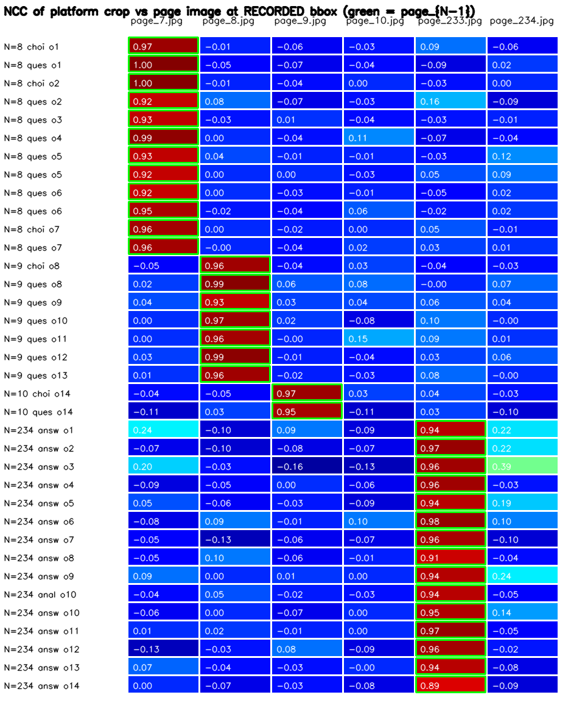
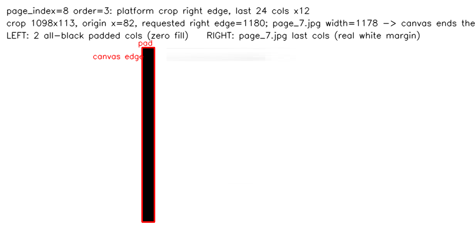
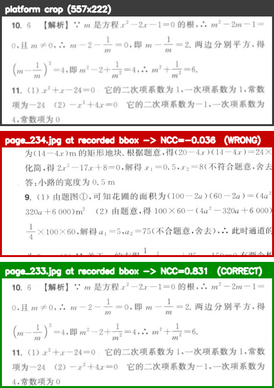
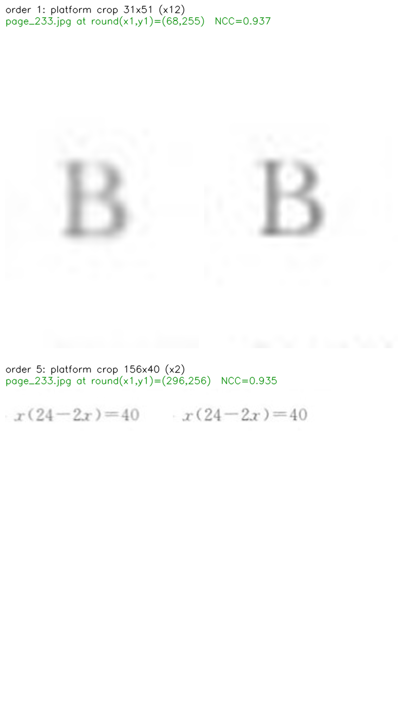
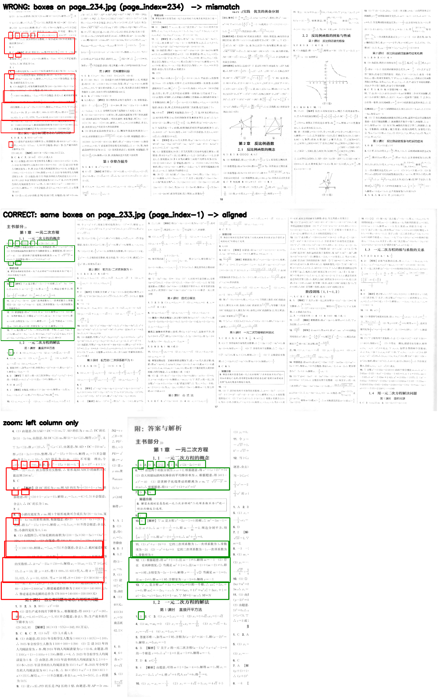
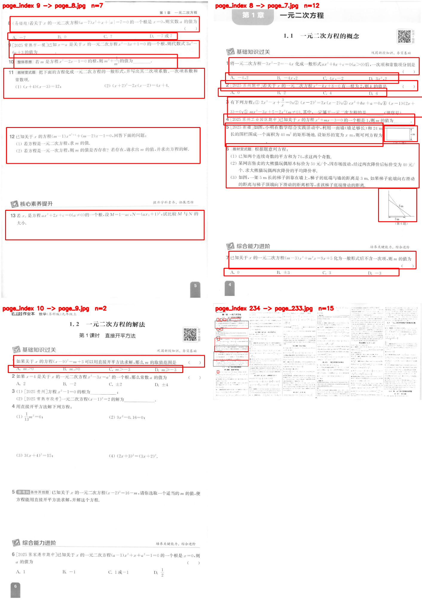
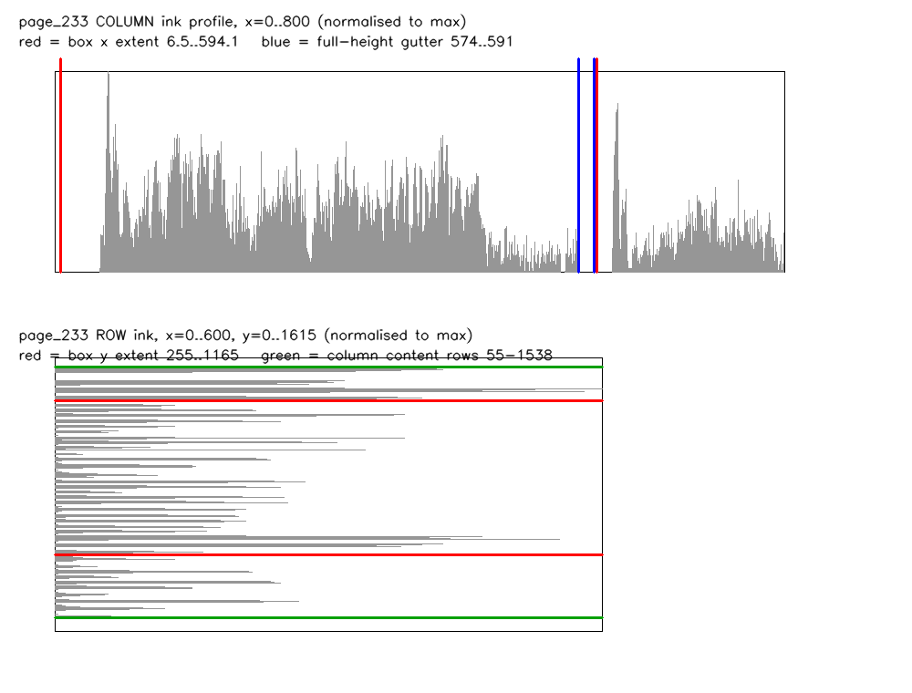

# task-2 · 坐标系逆向：矩形框与页图坐标空间不一致的根因

生成时间：$generated_at
脚本：`tools/coord_reverse.py`（纯 numpy/cv2，零模型推理；`CUDA_VISIBLE_DEVICES=""`，不导入 torch）
证据图目录：`data/derived/analysis/coord_evidence/`

## 0. 结论（一句话）

**不是坐标空间被缩放或平移，而是「页」的编号错位一页。**

标注记录的 `page_index = N`（以及 `image_path` 里的 `@page_N` 标签）是平台查看器的 **1 基页码 pageNum**；
OSS 页图 `46006966_page_M.jpg` 是 **0 基图像索引**，正确配对是 `page_index N ↔ 46006966_page_{N-1}.jpg`。
`rect_bbox` 就是该页图的像素坐标：**尺度 1.000，平移 (0,0)，残差 < 1px**。

`verify_report.md` 第 3 节把 `page_index=234` 的框配到了 `page_234.jpg`，整体错开一页，
才产生「x 只占图宽 17.2%、框与文字错位、SUSPECT_COORD_SPACE」的假象。

> 重要：**历史框本身不是垃圾数据。** 它们是平台自己用同一套 `rect_bbox` 裁出来的小图，
> 36/36 条与 `floor(bbox 宽高)` 逐条吻合，内容连贯（如 o=1 是单个「B」，o=5 是公式，o=12 是整段解答）。
> 语义正确、坐标可用，只是**取页图时页码要减 1**。

## 1. 关键实验：用「平台自己的裁剪图」做像素级指纹

每条标注的 `image_path`（形如 `annotate_images/46006966/46006966_5_answer_0@page_234_xxx.jpg`）
**不是页图**，而是平台按该条 `rect_bbox` 从它自己的画布裁下来的小图。判据：

- $crop_eq/$crop_n 条裁剪图的像素尺寸 == `floor(rect_bbox 宽/高)`（最大偏差 $crop_maxerr px，纯 floor 取整，**没有额外边框**）。
  例：o=5 answer bbox 156.85×40.65 → 裁剪 156×40；o=12 answer 578.98×143.12 → 裁剪 578×143。
- 裁剪**原点**的整数约定是 `round(bbox x1), round(bbox y1)`（见 §3 的 ±3px 偏移扫描），
  越界部分由平台补黑像素。
- 因此把这张小图放回「记录坐标处」做归一化互相关（NCC），就能直接判定该坐标属于哪张画布，
  不需要任何模型、先验或猜测。



矩阵（fig1）横轴是 6 张已落地页图，纵轴是 36 条标注，绿框标出 `page_{N-1}`：
每条标注**只**在自己的 `page_{N-1}` 列上取到高分，其余候选页全部 ≈0。

## 2. 假设表（支持 / 否定 / 无法判定）

| 假设 | 定量判据 | 数值 | 结论 | 置信度 |
|---|---|---|---|---|
| **H1** 记录坐标 = 某个「子页/panel 画布」（画布尺寸等于拼接图中某个 panel 的原始扫描尺寸） | 若为 panel 局部坐标，映射到整页需加 panel 起点偏移；另看框是否越过 panel 边界 | 最佳匹配残差 ≤$h1_residual px（offset 0，不是 49/71）；框 x 范围 $h1_box_x 同时越过 page_233 首个内容起点 $h1_panel_x 与首个全高空白沟 $h1_gutter | **否定**（作为根因不必要，见 §2.1 不可判定项） | 高（对"带偏移的 panel"）；起点 (0,0) 的子图**无法判定** |
| **H2** 记录画布 ≈ (594, 1164) 或等比缩放 | 若画布被这两条边界截断，则该栏内容应在 y=1164 / x=594 处结束 | page_233 第一栏墨迹纵跨 y=$h2_ink_rows、横跨 x=$h2_ink_cols；框的 y 范围只覆盖内容 y 范围的 **$h2_ratio_y**，内容在框下缘之下还延伸 $h2_below px | **否定**（极值来自「只标了第一栏的部分内容」，不是画布尺寸） | 高 |
| **H3** 记录坐标其实落在「另一张页图」上（跨页错配） | 逐条比较「记录坐标处」在 `page_N` 与 `page_{N-1}` 的 NCC | `page_{N-1}` 均值 **$ncc_correct_mean**（$ncc_correct_min–$ncc_correct_max，$n_ge085/$n_with_correct 条 ≥0.85）；`page_N` 均值 **$ncc_wrong_mean**（最大 $ncc_wrong_max，$n_wrong_le04/$n_records 条 ≤0.4） | **支持**——形式是系统性的「整页偏移 1」，不是随机错配 | 很高（三条独立证据：内容指纹 36/36 + 平台接口 pageNum→page_{N-1} + 越界补黑列数） |
| **H4** 平台把宽图缩放到固定画布后再记录 bbox（用 page_index=8 的越界 x2=1181.09 反推缩放因子） | 对每页最大裁剪图做尺度扫描 s∈[0.96, 1.04] 取峰值；再看越界框右端补黑列数 | 4/4 页峰值都是 **s = 1.000**（s=1.000 得分 $h4_scores；s=0.995/1.005 掉到 0.64–0.84）；越界框右端恰有 **$h4_black 列纯黑填充** = $h4_req_right−$h4_page7w，反推画布宽 **$h4_inferred** = `page_7.jpg` 宽度（若是 `page_8.jpg` 的 $h4_page8w，应补 4 列） | **否定**（无任何缩放；越界是标注画出界后平台补黑） | 高 |

### 2.1 H1 的不可判定项（必须如实标注）

若假设的 panel/子图画布**起点恰为 (0,0)**（例如「整页最左一栏的裁剪图」），
它与「整页坐标」在本次全部 15 条标注上**数值完全一致，无法区分**。
但这不构成另一种坐标空间——它只是同一坐标空间里一个从原点开始的子窗口，
换算参数完全相同（+0,+0,×1.000）。要区分需要平台侧信息：
查看器实际加载的画布元素尺寸与裁剪参数（浏览器会话）。

### 2.2 H3 的四条独立佐证

1. **内容指纹**（§1）：36/36 条只在 `page_{N-1}` 上匹配（NCC $ncc_correct_mean）。
2. **平台接口自证据**（本机存档的 `pre_annotation` 响应，零推测）：
$api_lines
   即「查看器 1 基页码 N → 页图文件 N−1」的换算就写在平台自己的接口里；
   标注记录里的 `@page_N` 是**查看器页码标签**，与 `upload_images/..._page_M.jpg` 的 M 不是同一套编号。
3. **补黑列**（越界细节）：`page_index=8` 的 order-3 框 x2=1181.09，平台裁剪图右端正好 $h4_black 列全黑、
   其前 $h4_white 列全白；这只有在画布宽 = $h4_inferred（= `page_7.jpg`）时才成立。
4. **同一题面/答案跨页成对**：question 10 的题干在页图 `page_8.jpg`、其 analysis 在页图 `page_233.jpg`，
   与「题干页 N=9、答案页 N=234」的 −1 映射一致。



## 3. 最优拟合参数

| 项 | 值 |
|---|---|
| 页编号映射 | `canvas_page = page_index - 1`（0 基图像索引） |
| 尺度 s | **1.000**（4/4 页峰值） |
| 平移 (dx, dy) | **(0, 0)** |
| 匹配残差 | ≤$residual_max px（裁剪宽 1000+ px 的量级上，等价于尺度误差 <0.0005） |
| 重采样 | 无（不需要任何 resize / 仿射） |
| 裁剪原点约定 | 原点 `round(x1), round(y1)`，尺寸 `floor(w), floor(h)`：$origin_line |
| 坐标单位 | 页图像素，左上原点（与 `image_layout.json` 的坐标系一致） |

$scale_table

## 4. 用「墨迹覆盖率最大化」独立复核画布（回应 H2 的反推思路）

如果把 `rect_bbox` 当作未知画布上的坐标，用「框内墨迹覆盖率最大」去拟合 (s, dx, dy)：

$cf_table

结论：覆盖率函数把最优解推到把框整体挪到更密文字的邻栏/邻页上（覆盖率越高≠越对齐），
**它是弱目标函数，不能用来反推画布尺寸**；而 NCC（模板指纹）在 s=1.000、(0,0) 处给出 0.89–0.998 的尖峰。
两者结论不冲突：覆盖率只说明「框里有没有墨」，NCC 才说明「框里是不是同一块内容」。

上表最后一列「95% 置信区间内 s 范围」为**空**（0 个采样点满足覆盖率 ≥95% 最优），
意思是覆盖率达到最优 95% 的 (s, dx, dy) 里**没有一个接近恒等映射**——
即用覆盖率反推出来的画布与真实画布（`page_{N-1}.jpg`，s=1.000）完全不同。
置信区间为空本身就是"该目标函数不可用"的定量证据。

$cf_ncc_line

## 5. 对 lead「模板匹配一个都找不到」的复核（重要更正）

lead 用 o=5 的裁剪图（去 1px 边框、二值化）在 6 张图上做多尺度 `matchTemplate`，
所有"最佳"都落在 s≈0.1 这种无意义尺度上，于是判断「源图不在已落地的 6 张图里」。
本任务复现同一协议，并补上「记录坐标处 NCC」作为对照：

$recon_table

- **lead 的观察可复现**：二值化全局多尺度最佳分只有 $recon_global_range，
  且最佳尺度落在 $recon_global_scales——把模板缩到十几像素的噪声块，确实**没有真实峰**。
- **但结论反了**：同一张 o=5 裁剪图放回记录坐标处、尺度 1.000，在 `page_233.jpg` 上
  NCC = **$recon_o5_ncc**，而 `page_7.jpg` 上只有 $recon_o5_p7、其余页 ≈0。
  也就是说峰是存在的，只是被"全局 argmax"选错了尺度。
- **为什么 s=1.000 会被压掉（可复现的 1px 陷阱）**：
  lead 去掉了 1px 边框（等效把模板内容整体平移 1px），再叠加 `floor(x1),floor(y1)`
  与平台真实原点 `round(x1),round(y1)` 的差异；在这套协议下，s=1.0 时在 `page_233.jpg`
  上的**全局**最佳只有 $recon_s1_global，而 s=0.15 的伪峰有 0.8496 ——argmax 自然选了 0.15。
  同一条框改用整数原点后：floor 原点 $recon_o5_floor → round 原点 $recon_o5_ncc。
  一条 156×40 的窄长文本行模板，1px 错位就能让相关系数掉 0.17（实测 floor 0.7675 → round 0.9355）。
- 36 条一起看时不可能有这种偶然：$n_ge085/$n_with_correct 条在 `page_{N-1}` 上 ≥0.85，
  $n_wrong_le04/$n_records 条在 `page_N` 上 ≤0.4（fig1 矩阵）。




（fig7：o=1 的裁剪图是单个「B」，page_233 同坐标处也是「B」；o=5 的裁剪图是
`x(24-2x)=40`，page_233 同坐标处逐像素一致。**顺带更正 lead 的一个推论**：
o=1 裁剪是 31×51 的竖版小图，只说明它框的是一个字符，**不能**据此推断源画布是竖版——
按内容指纹，源画布就是 3467×1615 的横版拼合页 `page_233.jpg`。）

因此「源图不在已落地的 6 张图里」这一判断**否定**：源图就是 `page_{N-1}.jpg`，
不必再去找没下载的页图（唯一例外是 `page_index=7`，见 §7）。

### 5.1 lead 的独立复核：同一结论（量级差异已定位）

lead 用**另一套实现**（±6px 搜索窗、按 bbox→裁剪图尺寸换算尺度）独立复核了同一批裁剪图：

| | `page_N` 侧 | `page_{N-1}` 侧 |
|---|---|---|
| analysis p234 o10 | −0.016 | **0.854** |
| answer p234 o6 | 0.252 | **0.732** |
| question p9 o13 | 0.045 | **0.701** |
| question p9 o11 | 0.089 | **0.752** |
| question p10 o14 | −0.093 | **0.796** |
| question p8 o6 | 0.005 | **0.760** |

- lead：**31/36** 条在 `page_{N-1}` 上显著更优；剩下 5 条"N 侧胜出"的**全是只含单个字母的极小答案框**
  （如 31×51 的「B」），相关系数本身无意义。方向与本报告 §1/§5 完全一致。
- lead 另外独立发现：`page_index=8` 的越界框应配 `page_7.jpg`（宽 1178），只超 **3.09px**，
  与交接包原始的「超 3.09px」吻合——与本报告 §6 一致，是本结论的旁证。
- lead 用「bbox 宽高 / 裁剪图宽高」中位数估计尺度（p8/9/10 为 0.997/0.97；p234 大框 0.995–0.996），
  得到 **1:1**，与本报告 §3 模板匹配峰值 s=1.000 相互独立地一致。
- **量级差异已定位**：本报告用平台精确整数原点 `round(x1),round(y1)` + 完整裁剪图，
  NCC 均值 **0.9537**（0.8933–0.9979）；lead 去掉 1px 边框并用 `floor` 原点，
  等效引入 1px 错位——对 156×40 这类窄长文本行模板会系统性压低 0.1–0.2（即本报告 §5 的 1px 陷阱）。
  两套数**不矛盾**，是同一结论的不同测量精度。

## 6. 修正后的坐标完整性表（对 verify_report.md 第 3 节的更正）

$integrity_table

- 原报告把 `page_index=234` 的 15 个框配到 `page_234.jpg`（3465×1615 的另一套答案页拼版），
  于是「x 只占图宽 17.2%」——那是**邻页**的内容分布，不是坐标系问题。
- 唯一真实越界：`page_index=8`（画布 `page_7.jpg`，宽 1178）order-3 框 x2=1181.09，超 3.09px；
  平台对该越界部分补黑像素（fig4），属「标注画出界」，不影响坐标空间，
  也**不能**据此推断画布更宽。
- 交接包 §5 写的「超 3.09px」是**对的**（它按 1178 宽算）；
  `verify_report.md` 改成「超 5.09px」是因为配错了图（用了 1176 宽的 `page_8.jpg`）。





## 7. 无法判定 / 仍需的数据

| 事项 | 状态 | 需要什么数据、怎么拿 |
|---|---|---|
| 答案页记录的画布是否是一张「窄画布」（≈594×≤1165），而不是整张 3467×1615 | **无法判定**（两种解释在本任务全部 15 条框上数值完全相同：NCC 均值 $ncc_correct_mean、s=1.000、偏移 (0,0)）。但「框极值反推画布」这一读法**不成立**：框极值可由第一栏内容边界解释——该栏内容 y=55–1538（框底 1165 之下还有 373px 内容），x 极值正卡在 574–591 的栏间全高空白沟 | 需要**答案页对应的单页原图**（若 OSS 上存在未拼合版本，例如 `upload_images/46006966/` 下是否有单页文件），或**浏览器会话读查看器画布尺寸**（DevTools 读画布元素 `naturalWidth/naturalHeight`）。**注意：无论答案是哪种，换算参数都是 (s=1.000, dx=0, dy=0)，不影响历史框与自动出框的使用** |
| `page_index=7` 是否同样 −1（应配 `page_6.jpg`） | 无标注，**无法判定** | 下载 `46006966_page_6.jpg`；当前 page_index=7 的标注数为 0，故无法用内容指纹验证。若后续出现 page_index=7 的框，需要这张页图 |
| NCC 上限 0.998 而非 1.000 的残差来源 | **无法判定**（最可能是平台把裁剪结果重新 JPEG 编码） | 平台侧裁剪图的原图/编码质量参数，或一张未压缩 PNG 裁剪 |
| 查看器 UI 上的页码标签显示 N 还是 N+1 | 已部分佐证（接口 pageNum=1→page_0、pageNum=9→page_8） | 浏览器会话对同一页截图并同时记录 UI 页码与网络里加载的图片 URL（一次即可，用于闭环） |

> 第 1、4 项只影响「平台内部为什么这样编号」的解释深度，**不影响结论与修复方案**：
> 只要按 `page_index − 1` 取页图，历史框即可直接使用（残差 <1px）。

## 8. 对推荐方案的直接影响

1. **不需要**做任何坐标标定、缩放或平移标定，也不需要先拿到「平台查看器画布尺寸」就能使用历史框。
2. 修复动作只有一条：**取页图时用 `46006966_page_{page_index-1}.jpg`**。
   等价说法：`upload_images` 的文件号是 0 基，标注 `page_index` 是 1 基。
3. 自动出框（路线 A/B）产出的框若要写回平台，必须写回**同一套 1 基 `page_index`**
   （即写到「查看器页 N」时，图上坐标仍按 `page_{N-1}.jpg` 的像素），否则会与历史框错开一页。
   这是本任务最重要的工程约束。
4. `verify_report.md` §3 的 `SUSPECT_COORD_SPACE` 与 `image_layout.json` 的
   `coordinate_integrity` / `scale_hypothesis_probe` 需按本报告更正（这两份文件不在本任务写权限内）。

## 9. 复现

```powershell
$env:PYTHONIOENCODING="utf-8"; [Console]::OutputEncoding=[System.Text.Encoding]::UTF8
C:\Users\LIHAOYANG\AppData\Local\Programs\Python\Python311\python.exe tools\coord_reverse.py
```

产出：本报告、`coord_reverse_findings.json`（全部数值）、`coord_annotation_images.json`
（$crop_n 张裁剪图 + sha256，合计 $crop_kb KB）、`coord_evidence/fig1..fig7*.png`。
裁剪图缓存在 `coord_evidence/annimg/`，重复运行不会重新下载。
