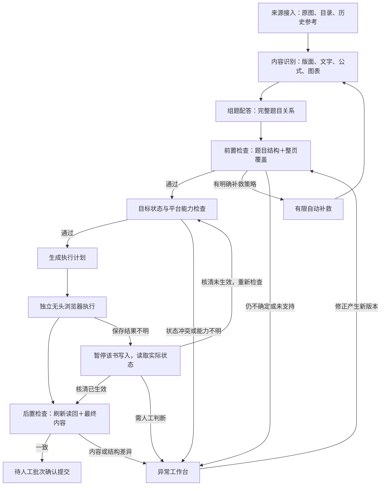

# 自动化架构 v2：自动推进、异常处理、人工最终提交

日期：2026-10-16。状态：初始架构设计，以下自动推进与模块边界属于目标设计。

> 2026-10-23 当前实现：46007447 第一课时 17 题已由程序真实保存、独立读回并核对导出，10 张题图加载通过；[闭环证据](usense-first-lesson-closure-20261023.md)、[运行索引](run-index.md)与[集成路线](integration-route-20261023.md)。通用无人值守章节处理、正式平台复审及 A 接收未因此通过。旧设计不能代替本次限定实现和当前操作授权。

本设计依据当前对话调整：正常题默认自动完成识别、组题配答、检查与录入；人工处理异常、进行抽查，并最终确认提交。逐题人工批准不再是正常流程的前置条件。

开发入口：[接口约定](contracts-v1.md) · [模块分工与里程碑](development-plan.md)。原 [识别路线研究](solution.md) 保留为算法试验记录；与本设计冲突的模块边界、主键及全局数据格式，以本设计为后续开发依据。

## 1. 产品目标与验收终点

使用流程：选择书籍及范围 → 启动任务 → 自动运行 → 集中处理异常 → 批次检查 → 人工最终提交。

- 正常题经过程序检查即可继续，不需要在工作台逐题点“通过”。
- 支持提交前完整内容检查时，自动运行终点是“已录入并核验，待最终提交”；提交后才触发 OCR 的分支见第 6 节。不能把生成 JSON 或收到保存响应称为完成。
- 人工最终提交后，若能观察平台反馈和重新读取结果，才记录“已提交确认”；无法核实时标记未确认。
- 组合题、跨页、公式、图表、七选五仍属于目标支持范围。可以分阶段开发，但未支持的类型必须显式进入异常统计。
- 运行前明确书籍、目录/页范围及允许操作。开发文档不替代当前只读调查范围的线上写入授权。

推荐单仓库、模块化单体。首版用 Python 后端、文件产物、SQLite 状态和轻量本地工作台即可；模块先通过函数与 JSON 交换，不先部署多个服务。

## 2. 主流程与异常旁路

图示为提交前能够完成内容核验的主路径；提交后 OCR 的特殊分支按第 6 节处理。图中的自动补救表示回到受影响阶段：扩大裁片只重做相关识别；答案上下文不足只补采集和配答。无需每次从整本书重新开始。

工作台显示进度、费用、异常和抽查预览。它消费主流程产物，正常题不会先进入人工等待队列。

## 3. 六个功能模块与运行底座

| 模块 | 输入 → 输出 | 职责 | 边界 |
|---|---|---|---|
| 来源接入 source | 任务范围 → SourceBundle | 导入原图、目录、资源映射及历史参考，检查完整性与哈希 | 不做切题或写平台 |
| 内容识别 recognition | SourceBundle → EvidenceBundle | 分片、检测、OCR、公式/图表识别，保留原图坐标及证据 | 不决定最终题答归属，不输出平台操作 |
| 组题配答 assembly | EvidenceBundle → QuestionGraph | 识别题目语义，合并跨页，组织小问，匹配答案与解析 | 不操作浏览器，不以平台题序充当内部身份 |
| 自动检查 quality | 来源、证据、图谱、目标快照/平台读回 → CheckReport | 内容前置检查、目标状态/能力检查、后置录入与内容检查；给出问题和补救建议 | 不执行重试、不调用平台写入、不自行修改候选 |
| 平台交付 delivery | 通过检查的图谱＋目标快照 → ApplyPlan → ExecutionReceipt | 投影平台规则、增量计划、执行、核对实际效果 | 不重新识别题目，不临时猜答案 |
| 异常工作台 exceptions | 问题及证据 → ReviewPatch | 查看原因、修正、暂存、抽查，形成有来源的新版本 | 不绕过检查直接写平台，不覆盖旧结果 |
| 运行底座 runtime | 任务及阶段结果 → 状态/事件/账本 | 调度、缓存、费用、限额、浏览器生命周期、持久化和恢复 | 不包含题型、分栏、Q/W/A/E 等业务判断 |

quality 的检查逻辑独立于生成算法。首版可以由同一人实现两者，但必须有不同的入口、输入和失败样例。

平台交付再分三个内部单元：planner（纯计划）、executor（页面操作）、reconciler（核对未知结果）。它们不需要拆成独立服务。

## 4. 正交性的四条核心规则

### 4.1 原图内容、题目语义和平台表示分开

- 内容类型：text / formula / image / table。
- 题目角色：stem / option / answer / explanation / shared_material。
- 平台表示：Q/W/A/E、平台框类型、平台题序等。

例如组合题的小选项，在内部仍是 option；交付层按已确定的业务政策映射为 Q。公式在内部可保留专门的内容类型，在当前平台按文本类型交付。模型和检测器无需理解这些平台差异。

原始需求的普通选择题每选项独立框，与历史视频的合框表现存在差异。政策文件记录采用口径、来源和确认状态；受影响规则未确定时不能静默自动放行。

### 4.2 统一身份与坐标

- question_id 是内部稳定身份，印刷题号、目录 ID、order_in_level 是可重复或会变化的外部属性。
- 题目匹配综合书籍、目录、印刷题号、小问、顺序和内容证据；不能依靠某个全局题序匹配未知新题。
- 所有通用框使用原始图像像素坐标，并绑定 asset_id、尺寸和哈希。
- 分片/缩放变换由 geometry 工具处理；浏览器 CSS 坐标只在平台适配器中出现。
- YOLO 归一化框仅作为某个训练/检测后端的输入输出格式。
- 当前样书已核实的 N → N-1 页资源映射封装在来源适配器，不推广为所有来源的固定规则。

### 4.3 有头/无头仅改变运行方式

运行底座启动专用浏览器，管理独立 profile、固定 viewport、登录有效性、截图与故障现场。平台适配器使用相同操作代码。

日常录入使用无头模式；登录和人工接管使用专用有窗口模式。一个 profile 同时只有一个浏览器进程，同一本书只有一个写入者。先验证单任务；跨书并行仍需验证平台账号的多会话行为。

切换模式前核对草稿是否持久化、保存检查点、释放旧进程；不得假定未保存的页面内存能跨重启保留。两种模式都不接管日常 Edge 配置目录。

### 4.4 版本化产物代替共享可变状态

模块只读取明确版本的输入，输出新产物；不修改别的模块文件或直接操作它的数据库表。

人工修改是绑定基线版本的 patch。重识别产生新版本；可以证明不冲突的修改才自动迁移，有冲突的变更进入异常。已录入版本发生修改时重新生成增量计划，不能复用旧回执。

模型、识别器或浏览器模式变化，应只影响对应适配器和配置，不改变其他模块的业务语义。

## 5. 自动检查与自动补救

CheckReport 同时包含题级检查与页级覆盖检查。检查结果是操作依据，不代表数学意义上的正确性证明。

| 检查层 | 必须观察的内容 | 典型问题 |
|---|---|---|
| 来源 | 范围内页图、目录、资源映射、尺寸与哈希 | 缺页、错页、来源变化 |
| 整页覆盖 | 从整页文字/图块/题号线索出发，记录归属、明确排除和未归属区域 | 整题漏识别、图形漏掉、跨页未闭合 |
| 题目结构 | 题干、选项、小问、片段阅读顺序、重复与缺失 | 两题误合、选项缺项、子题归属错误 |
| 配答 | 章节上下文、题号重置、候选唯一性、答案与解析归属 | 题号相同但章节不同、答案跨入邻题 |
| 目标平台 | 当前题目/目录状态、能力、规则版本、计划前置条件 | 目标被他人修改、所需操作未验证 |

覆盖检查不能只遍历已生成题目，也不能以“框覆盖全部黑像素”或“题号连续”证明没有漏题。保留不同于切题结果的整页证据；对页眉、留白、说明等排除项给出依据。与识别算法共享的证据必须标明，避免把同一结论当成两次独立验证。

统一决策：
- PASS：本阶段必需检查通过，允许进入下一阶段。
- RETRY：存在具体补救策略且次数、预算允许；运行底座安排补采集、扩上下文或更换识别后端。
- EXCEPTION：需要人工处理，或当前支持范围之外。
- HOLD：运行条件不成立，例如登录失效、预算暂停、平台状态未知。

有限补救示例：扩大边缘裁片、读取相邻页、增加答案上下文、切换公式识别器。每种策略有次数上限和费用上限；不能无限重复相同提示或同一个输入。

自动放行范围按题型、版面和识别版本管理。先用经人工核准的开发/验证样本制定规则，再在独立留出样本上检查漏错；模型自报置信度只作辅助证据。

## 6. 平台执行、OCR 与保存语义

### 6.1 执行和核验

计划绑定具体图谱版本、规则版本、内容和目标两份通过报告及平台快照。quality.targetcheck 负责目标状态、能力和允许范围检查；只有内容检查与目标检查均通过，planner 才生成计划。每一步记录目标、前置条件、预期变化及动作标识。

执行结果分为：
- APPLIED：本次动作的预期变化得到重新读取的支持。
- NOT_APPLIED：有明确证据未生效，才可按策略重试。
- UNKNOWN：超时、断线、读回矛盾或无法确认，进入 NEEDS_RECONCILIATION。

UNKNOWN 时暂停同一本书后续写入，读取实际状态并与原计划核对。核清已生效则进入后置检查；核清未生效则重新检查目标前置条件，再决定续执行或重新规划。独立的离线识别任务可继续。同一动作再次启动前先核对日志和平台状态，不能通过重复提交整题“试试看”。

本地 action_id 能防止本程序重复调度，但不自动提供平台的 exactly-once 保证。崩溃发生在平台保存之后、本地回执落盘之前时，恢复必须先核对实际状态。

### 6.2 发现平台能力，再选择流程

平台适配器报告经过验证的能力：草稿持久化、框读回、内容读回、OCR 触发时点、重开恢复、提交是否不可逆。

- 若 OCR 在保存框后、最终提交前完成：等待 OCR，读取结果，做后置内容检查，然后进入待提交。
- 若由本系统提供最终文本：检查平台实际接收的文本、公式、图片与结构。
- 若 OCR 只能由最终提交触发：提交前只能证明框与对应关系已核验；标记 CONTENT_PENDING，最终人工提交后再读取 OCR 内容并检查。
- 若没有可恢复草稿，或该能力仍是 UNKNOWN：先生成本地批次预览，本批从执行开始就使用可人工接管的同一专用会话，并保持到人工提交。首版采用专用有窗口会话；只有验证过不会丢状态的接管方式才允许切换。后台持久录入能力保持未验证。

同会话有窗口方案须显式选择并验证，再生成对应计划；它不要求重启后草稿恢复，其他必需能力仍须核实。planner 不能在执行中悄悄切换模式。

不能把保存成功或 OCR SUCCESS 等同于题目正确。公式检查需要关注结构、缺项和图像证据，不能承诺字符串相等即可证明数学语义正确。

READY_FOR_SUBMISSION 只用于必需检查均已完成的批次。内容只能提交后检查时，使用 AWAITING_HUMAN_SUBMIT_FOR_OCR，并明确显示尚未验证内容。

## 7. 异常工作台是旁路

只提供首版必要能力：
1. 按原因列出异常，显示受影响的题、页和阻断动作。
2. 题目原图、答案原图和候选结构并排查看；支持补框、调框、拆并、改归属、换答案。
3. 保存 patch，重新检查受影响范围；跨页/公共材料修改会使依赖题目检查失效。
4. 显示录入差异和未知保存现场；处理未知保存时先核对平台，不先重写。
5. 展示正常题抽查预览与整页覆盖图，以及最终批次统计。

内容错误按题/关联题组处理；完整性问题可能阻断该页或目录单元；登录和未知保存等运行问题按书籍合并为一个异常，避免为每道题重复报警。

用户可推迟异常，继续独立工作单元。未处理题仍计入总范围和待处理统计；若允许部分提交，必须明确列出被排除部分，不能把剩余题静默算作完成。

## 8. 状态、成本和评测

主状态：
`QUEUED → SOURCED → RECOGNIZED → ASSEMBLED → CHECKED → PLANNED → APPLYING → VERIFYING → READY_FOR_SUBMISSION → COMPLETED`

另存两个独立字段：submission_status = NOT_SUBMITTED / CONFIRMED / UNKNOWN；content_check_status = PENDING / VERIFIED / MISMATCH / UNAVAILABLE。COMPLETED 要求人工提交已确认、必需的框结构检查通过且最终内容已核验。已提交但 OCR 尚未结束或内容有错的批次不能进入 COMPLETED。

旁路：
`RETRY_PENDING / NEEDS_REVIEW / UNSUPPORTED / LOGIN_REQUIRED / BUDGET_PAUSED / NEEDS_RECONCILIATION / CONTENT_PENDING / AWAITING_HUMAN_SUBMIT_FOR_OCR`。
每个旁路状态记录恢复条件、恢复阶段和依赖版本；最后一个状态在人工提交后回到 VERIFYING，保留 submission_status，再更新内容检查结果，不能直接跳到成功。

文件保存原图引用、版本化产物与截图；SQLite 保存任务状态、写入锁、动作日志、外部 ID 对应及调用账本。重启后先处理未决写入，再恢复其他工作。

模型调用统一经过网关，记录模型/提示版本、输入摘要、usage、价格版本、耗时、失败与重试。未知账单金额标记未知，不能记为零。缓存键包含输入哈希、模块/模型/提示/政策版本及参数；对失效依赖只重算必要阶段。

每批报告：
- 自动完成率：在固定测试范围内，无需人工修正且达到约定自动终点的题数 / 全部应处理题数。
- 漏错率：独立核查中，自动通过题里实际有错的比例；说明抽样与样本量。
- 每百题人工分钟：异常、抽查、最终检查及返工均计入。
- 每道合格题模型费用：全部调用费用（含失败/重试）/ 最终验收通过题数；分母为零时只报总花费。
- 总耗时、重复录入、未知保存、未支持/跳过和缓存命中情况。

只有候选集合无法知道“全部应处理题数”；验证集必须建立独立清单，生产报告则注明已知总量及页级覆盖的剩余不确定性。

## 9. 当前证据与设计之间的距离

本轮只读核对的远端基线：`origin/main = 561ca5a`；本地开发基线 `3fb3bca`。现有 6 张样图、14 题、36 个历史框用于开发参考，历史框及自动紧致框均不能直接成为独立真值。

可复用：取图/哈希、宽图分片、版面候选、OCR 后端探测、叠图和页映射核查。尚需实现/验证：新题配答、独立质量检查、异常工作台、运行底座、独立无头会话以及真实画框保存读回。

先完成 [开发计划 M0–M2](development-plan.md)，即可同时推进算法与平台端；无需等识别模型达到最终准确率才开始平台开发。

参考：[探索清单](../试题标注项目_探索清单与技术路线_20261015.md)、[页映射更正](../data/derived/CORRECTION-page-mapping.md)、[现有脚本](../tools/)。
