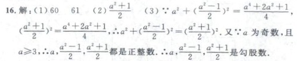

# Q16 来源区域正文重建

2026-10-17，Asia/Shanghai；基线 `2934a43d8df7bd09b05ce4e8153dfb5d26335fc9`，B 侧离线增量。代码、固定计划与评估随本页所在提交交付；实际记录见 [区域重建评估](../evaluation/book-46007447-content-region.json)。网站标注未修改，公共合同及 A 接收仍待对方确认。

## 本次实际改变

第二课时 Q16 的原答案有 17 个片段：高位分子插在“60、61”之间，多处分母成为独立行，部分正文、外围平方和关系符未读到。F5 没有任何原 OCR 片段；F9 只有分母片段，旧两遍公式识别一致却都错，另一条候选还重复生成了第二个分式。原来的单片段编辑无法表达这些缺字与阅读顺序。

新增 `REBUILD_TEXT_REGION` 在同一内容修订入口消费显式来源区域草稿，实际重建当前答案及文字呈现区。新计划保留上一版 Q9 的 7 个操作，再加入 Q16 三行重建，共 8 项；Q16 的 17 个原片段按 7/3/7 分配给三块，活动正文含普通文字、11 处分式及外围符号，`regions` 与 `render_regions` 同步成为当前 typed 呈现。完整原片段、旧 legacy 呈现及旧错误仍分别保存在来源层和基底档案中。

**这三行是 MODEL_DRAFT 对原图的显式开发转写**，包括新写入的字和标点。它们不是某次 CPU 完整识别结果、多个模型输出的隐式拼合或人工金标准。本次没有新增 OCR/公式推理，不能据此宣布自动识别已解决 Q16，也没有把原有数学风险关闭。来源与投影审核通过，全部内容仍为 UNVERIFIED/HOLD，G1 完整答案验收尚未通过。

本次使用的固定裁片：



- 原资产 `viewer-173`，1148×1621，SHA `a231f0247cd0444cc34ed699c4cca99245d2ac6cfda5ef10a38ca3f8164510be`。
- 区域 `[579,263,1084,367]`；本地原 JPG 裁切与上述固定 PNG 逐像素相同。RGB 字节 SHA `4fa6dac45f65e9f50351edcbf0a87427b9a8283bcee2c8e89cb4957d4bd8dcb7`，与 PNG 文件 SHA 是不同口径。
- 它与 Q9 续页 `resource-173` 是不同资产；不按数字 173 混用来源或推断 viewer 页码。

## 操作、来源和版本

操作包含 `target`、`source_region` 与有序 `blocks`。target 明确当前答案、角色及全部目标原片段 ID；source_region 绑定当前 E 的资产 ID、原图 SHA、宽高及整数区域。每块有独立 bbox、原片段 ID、普通文字/LaTeX runs 和说明。块间换行，块内 runs 原样拼接；顺序来自显式草稿，不把旧原行排序字段改成新结果。

每个目标原片段必须恰好分配一次；允许某个新增块没有旧 OCR，但仍须位于明确原图区域，并作为未核准转写。新增文字没有伪造的原字符跨度。原 OCR 元素跨度、片段内编辑跨度和新块文字是不同坐标空间；新旧文本区间仍用 Unicode 码点。

生产者与独立审核分别验证：

- 当前 E/G05/Check05 与计划的引用、书籍及范围相同；目标单页 SHA/尺寸、角色、章节/栏/窗口与来源账本一致。
- 区域完整包含目标原 bbox；目标在原可见呈现区连续，不能跨图片、结构标记、其他角色或未选择文字。新块完整包含其分配的原片段，块互不重叠。
- 区域不能吞入其他题目/答案、图内诊断、未归属或排除的 OCR 行。每个原 allocation 仍归当前目标；区域操作不能与同片段编辑、选择、换行连接或另一片段组重叠。
- 原 fragments、source_line_ids、evidence_refs、202 行账本、5 个图形及行内 CPU 观察不变；显式修订层可以改变当前文字和呈现。旧 Check05 的 118 项问题完整归档，当前规则重新检查。

准备 CLI 对区域操作要求 `--source`，验证实际本地原图字节/尺寸、裁片 RGB，并检查创建计划过程中原图、manifest 或 JSON 输入是否改变。可重复该参数提供多个来源 manifest，同资产不能重复。应用及独立 QA 的 JSON API 核对 E 中来源身份、坐标及账本；它们本身不读取原图，也不证明字形或转写正确。正常流水线另有原图检查，实际像素核对回执单独记录。

| 输入计划 | 应用 / 图谱 / 当前检查 | 消费语义 |
|---|---|---|
| `b-content-revision-plan-trial/0.1` | application0.1 / G06 / Check06 | 原单片段选择/编辑及原行连接，保持旧行为 |
| `b-content-revision-plan-trial/0.2` | application0.2 / G07 / Check07 | 新区域块 `REGION_DRAFT`、多原片段及 typed runs；state/projection0.2 |

新操作不能放进旧计划。含新操作，或沿用已有 0.2 计划历史时，准备器生成 0.2；撤销后的空/旧操作快照也保持新版，不能静默降级。没有新增流水线阶段：仍复用 `content_apply` 和 `content_quality`，总链保持 14 阶段。

G07 的 `content_fragments` 可以是原单片段投影，也可以是带 `source_fragment_ids`、来源区域、块 bbox 和 runs 的 `REGION_DRAFT`。当前呈现按 `render_regions` 及 `content_fragment_ids` 读取；空旧 OCR 列表不等于新块无来源。受区域重建影响答案的 `regions` 与当前 typed 呈现一致，旧 legacy 值在 `base_graph_archive`。消费者必须显式适配新版本，不能按旧“一片段一个文字框”规则执行。

## 复现入口

固定完整操作清单为 `tests/fixtures/book46007447/content-region-operations.json`，计划为 `content-region-plan-v1.json`。该文件是本条区域开发分支的第一份计划，内部 revision=3，完整归档此前 v2/v1；不覆盖旧撤销分支的 `content-revision-plan-v3.json`。

准备计划时，先取得当前流水线的 plain E/G05/Check05。下面命令的路径指向接收方本地原图 manifest 和实际导出的当前对象；输出使用新文件名，已有文件拒绝覆盖。

```text
python tools/prepare_content_revision_b.py --evidence CURRENT_E.json --graph CURRENT_G05.json --base-check CURRENT_CHECK05.json --operations tests/fixtures/book46007447/content-region-operations.json --previous tests/fixtures/book46007447/content-revision-plan-v2.json --source LOCAL_SOURCE.json --author-kind MODEL_DRAFT --author-id codex-b-spatial-draft --author-note "Explicit unverified source transcription" --out NEW_REGION_PLAN.json
```

作者 note 是计划内容身份的一部分；上例会生成自己的计划引用，不能冒充固定计划原回执。固定输入可由已有 `content-revision-inputs.zip` 与 manifest 校验后重放，包内不含原图或人工金标准。没有原图时，JSON 重放只验证来源引用与投影，不能声称实际像素已重新验证。

正常流程继续使用 `tools/run_pipeline_b.py` 的 `--content-revision`，与原 `--inline/--inline-source`、回补及续接参数一起使用；该参数不会开启模型或网站动作。pipeline 的 PARTIAL/FAILED 不提供最终引用，READY 只表示本地阶段完成。

## 实际验证与当前限制

实际验证三行草稿的应用后停止、恢复、全缓存、只撤销 Q16 区域而保留 Q9、恢复原区域计划、坏应用物件拒绝/修复，以及物件已发布但 SQL 未提交时的真实进程退出/恢复。坏字节、旧计划、失败/中断 attempt 与孤立物件均保留；撤销和恢复都绑定当前版本。最终引用、源码及运行记录见评估文件。

当前仍是 34 题候选、66 答案候选和 34 个同范围唯一候选链接，202 行账本为 154 CONSUMED / 29 EXCLUDED / 19 UNASSIGNED。本计划影响 Q9、Q16 两个答案，没有新造题目或配答。Check07 当前 127 问题/HOLD：66 项来源风险保留、52 项当前题目规则 finding、9 项草稿风险；原 118 项完整归档。问题数增加来自新增显式草稿记录，不是准确率指标。

新回归覆盖真实 Q16，以及无旧 OCR 的新块、角色/来源/题目屏障、几何裁切、重复/丢失片段、跨操作冲突、协调重签篡改、旧版本混用、当前重检、撤销和原图执行中变化。独立审核不调用新生产者或公式解析器；其 accepted 是来源和投影一致性结论。

干净 Git 导出完整 1021 项回归通过（基线 984 + 新增 37，583.004 秒）；201 个源码、工具、测试及固定输入逐项核对一致。两个依赖环境各实际准备计划、核对相同原图裁片并执行完整 14 阶段，最终 E/G07/Check07 引用相同；完整套件仅在基础环境执行。8 份主线/故障执行回执和 2 份导出环境运行记录分别保留，不将合成故障测试写成真实平台实验。

后续继续推进自动二维识别与候选选择、原图与当前正文对照的可操作复核、独立人工内容核准；复杂公式及小标点仍待核对。原 Q9 的 `925.625` 等标点/漏字风险、19 条公共身份、完整章节/整书来源、独立留出及 A 消费者仍未完成。当前离线能力不接管 A 平台执行，长期目标继续进行。
