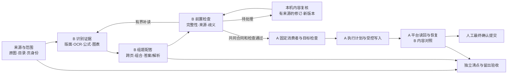
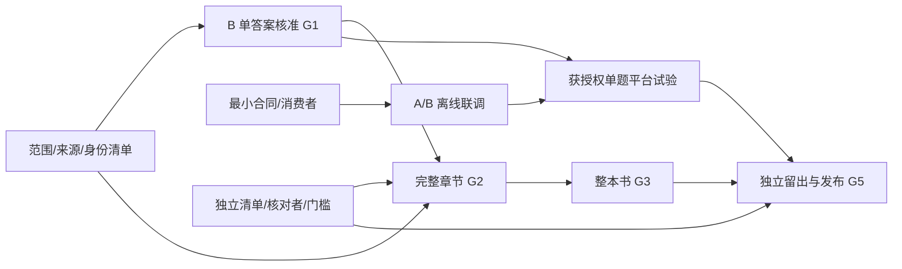

# 试题标注自动化：全项目实施框架

> 当前入口（2026-10-23）：[运行索引](run-index.md)、[第一课时 17 题真实闭环](usense-first-lesson-closure-20261023.md)、[分支集成路线](integration-route-20261023.md)。17 题真实保存/独立读回/导出已完成；正式复审、完整章节分母、通用无人值守与 A 验收仍按各自证据开放。
> 本文第 1–6 节保留 10 月 17 日规划及当时起点，其中“当前尚未进行平台试验”等句不是 10 月 23 日状态。[10 月 22 日现状](project-status-20261022.md)同属历史记录，不应覆盖新的完成证据。

提出日期：2026-10-17（Asia/Shanghai）。这是供 A、B 共同审查的实施路线，基线为 B 分支 `ba827373090518df32d48b872054730d7a4fbf11`。它把早期 [M0–M4 开发计划](development-plan.md)、[架构草案](architecture.md)、[定稿需求对照](requirements-confirmed.md)和 [B 长期 G1–G5 目标](b-long-term-goal.md)接成可交付的工作顺序。公共合同、A 接收及平台能力由 A 和双方验证后确定；本文件不替 A 宣告完成。

## 1. 终点与当前起点

使用者选择一本教辅和明确页/目录范围，系统从完整来源生成题干、**逐项独立选项框**、答案、可选解析及公式/图形/表格，建立跨页、组合题和共享材料关系。系统自动处理已验收支持范围内的正常题，把缺页、漏题、错配、无法读对、平台状态不明等集中交给人工；经受控执行、读回和人工最终确认后交付。任务可暂停、恢复、追溯和升级，不靠某一次浏览器会话或聊天记录维持状态。

当前可用的是 B 的局部离线流水线：46007447 的 6 个来源资产中已观察部分、识别候选/配答/质检、Q9 真实续接、Q16 三行自动草稿与来源候选复核，以及可恢复的 14 阶段内容链。当前 34 题候选、66 答案候选、19 条未取得公共身份的来源、127 项当前质检问题和 50 项单独的 Q16 来源风险都保留；结果仍 `HOLD`。Q16 有明确错字、漏符号/幂次，全文未独立核准。B 的本机保存/恢复不等于 A 的平台保存/读回；公共合同是草案，A 接收 `PENDING_A`。详细事实以 [B 状态](status/b.md)和对应评估文件为准。

项目按**可观察的交付关口**推进。日期取决于原图、目录、独立核对者和 A 的消费者就绪情况，不先给虚假的完成日。算法、来源准备、合同联调和验收样本可并行；只有有证据的关口才标通过。

早期 M0–M4 是**模块开发顺序**，不是整书验收结果；G1–G5 是**交付关口**，L1–L5 是各能力的详细验收要求。对应关系如下，任一旧阶段的单项回归通过都不能直接提升长期关口状态：

| 早期阶段 | 在本框架中的落点 | 长期退出条件 |
|---|---|---|
| M0 合同与样例 | 第 0 步的来源/身份和最小共同类型 | G1 前必须保留原图与内容来源；G2/G3 还需完整章节/整书分母 |
| M1 离线纵向闭环 | 第 1 步 B 内容闭环、第 2 步 A/B 模拟消费 | G1 对应 L1；模拟回执不算实际平台或内容核准 |
| M2 实际平台闭环 | 第 4 步获授权的单题试验 | G4 对应 L4；A 记录真实写入、读回和恢复 |
| M3 难例与异常修正 | 第 1/3 步的复杂内容和第 4 步的平台异常 | G1/G2/G4 分别验内容、章节和平台；单题回归不能代替整章 |
| M4 小批评测与交付 | 第 3–6 步的复核、整书、留出与发布 | G2/G3/G5 对应 L2/L3/L5，不能由局部实现宣称完成 |

## 2. 一张系统图

这是模块化单体的目标边界：原图、候选、活动正文、检查、计划、回执都是带版本的产物；运行状态和写入 intent 另存。B 算法不能因候选看似正确就调用平台，A 消费者也不能把 `READY`、结构审计通过或模型一致当成内容已核准。修订产出新版本并使受影响的旧检查失效，原始 OCR、失败和旧计划保留。

| 责任面 | B 的交付 | A 的交付 | 双方交接点 |
|---|---|---|---|
| 来源和身份 | 校验实际收到的来源、列缺口；候选不猜平台身份 | 可移植来源/目录、稳定身份和页映射；公共类型最终合并 | 同一范围清单、原图摘要、身份映射及缺口 |
| 内容 | 版面/OCR/公式、题答组装、跨页关系、来源账本、前置质检、本机内容修订 | 固定输出消费者；平台 Q/W/A/E、文字/图片/表格映射 | 当前图谱/检查、未决问题、正常及拒绝样例 |
| 执行 | 提供内容与后置对照规则，不接管平台会话 | 目标检查、计划、写入 intent、执行、读回、未知保存调和及平台异常工作台 | 计划所用内容版本、真实回执、平台读回差异 |
| 验收 | 逐题/逐页内容证据、回归及运行成本口径 | 平台能力和接收回执；公共合同及发布集成 | 独立样本、预先冻结的门槛、双方签收记录 |

B 已有的**离线内容复核界面**负责检查识别文字和来源；A 规划的**平台异常工作台**负责执行差异、目标状态和未决写入。两者可以先独立存在，之后通过明确的内容版本与回执引用对接。

## 3. 实施顺序：每一步做什么、为什么做、怎样过关

### 第 0 步：固定范围、来源、身份和最小消费合同（现在开始，A/B 并行）

**做法。** A 给一本书或首章的可移植原图清单、SHA/尺寸、阅读顺序、目录稳定 ID，以及 resource、viewer、印刷页码、平台题目、导出 tixu 的实测映射或 UNKNOWN。B 建“应有/已收到/已读/未读”账本，逐条登记当前 19 条材料的候选位置与待确认身份。双方只冻结最小共同类型、一个真实正常包、一个缺片段/歧义包、一个陈旧/未知版本包，指定可执行校验命令和消费者。现有 B 内部 `trial` 版本通过适配/拒绝进入共同合同，不直接升格为公共类型。

**原因。** 没有独立的页和题目分母，自动识别永远无法证明“没有漏整题”；同一个“173”可能是两个不同资产。先让消费者明确接受或拒绝真实输出，可在算法继续改善时暴露接口分歧。

**难点与处理。** 来源不全时将范围标为 PARTIAL，运行可继续但整章/整书关口不通过；身份不明时保留未归属，不用局部同号或位置猜测。合同争议用最小失败样例、生产者/消费者差异和迁移方案交 A 合并。通过证据是清单对账、相同 SHA 下两机正反例复现及双方记录的兼容结果；当前该关口未完成。

### 第 1 步：完成一个真实答案的内容闭环（B 主线，对应 G1）

**做法。** 以 Q16 为主例，逐行把正文核心、连接符号、分式、上标、括号和读序与原图核对；保留全部 OCR/公式原始观察与失败，增加有来源的补读和显式候选选择。复核者在冻结原图上独立逐字检查活动答案，标出每个内容块的来源、改动理由和剩余不确定处；选择/修订后只重建受影响正文、配答与质检。Q9 跨页和 Q4 既有错误作为防回退负例；Q16 缺对应题页时不造配答。

**原因。** 一个答案从源像素到当前正文再到独立核对全部闭合，才能说明结构、识别、复核和质量接口真的连通。继续增加候选数不能证明答案正确。

**难点与处理。** 模型两遍一致也可能同错；分量组合可能看似合法却不是原图公式；普通 OCR 的字符位置不等于精确字框。核对分子/分母、符号、指数、括号作用域和行间连接，未知语法保留原文。通过证据是独立核对记录绑定原图/当前版本、全文逐块无未决缺口、内容和结构检查分别通过；当前 Q16 未过关。

### 第 2 步：提前跑通 A/B 最小离线联调（与第 1 步并行）

**做法。** A 用固定图谱和最小消费者完成类型校验、目标快照、计划及模拟平台回执；B 提供当前 G07/Check07、旧版/歧义/损坏三个输入。双方在同一提交上验证正常消费、明确拒绝、陈旧版本和“写入成功但响应未知”的调和状态。A 的只读平台能力探测可并行记录，不据此启动写入。

**原因。** 平台字段、保存时点或版本行为若到整书之后才发现不兼容，返工最大。模拟异常先把状态机和幂等边界跑通，避免实际写入时猜测结果。

**难点与处理。** B 的旧碎片、活动 `REGION_DRAFT` 和图内诊断不能按“一条 OCR 等于一框”消费。UNKNOWN 需先读回核对，不能直接重试写入。通过证据是共同 SHA、固定输入/输出摘要、消费者正反例和 A 自行记录的接收结果；目前 A 消费者尚未收到可复现验收。

### 第 3 步：一章完整试交付（G2）

**做法。** 先选一章并冻结全部题页、答案页、目录、页/题/材料清单及审核人。用统一命令批量运行来源→识别→配答→前置检查；复核界面处理缺字、共享材料、跨页、选项、解析、公式/图形/表格。对每题标记自动可用、人工修订、未支持或缺来源，修订后重检相关题组。用独立清单和定稿需求逐项对账。

**原因。** 单题可能掩盖漏页、重复题号、跨题边界和人工处理成本；完整章节是能统计分母且仍可人工全面复核的最小业务单元。

**难点与处理。** 共享材料会使单题修改影响多个答案；组合题选项归题干，A–G 各选项仍独立框；无解析不能虚构 E 框。未支持/未解决项留在总分母和异常队列。通过证据是页/题/材料三层清点闭合、独立内容核对、需求矩阵与修订历史；材料未齐时只发布局部运行，不称章节交付。

### 第 4 步：获授权的单题平台试验（A 主导，与章节工作交错）

**做法。** A 在当次明确授权的范围内，先核对登录、原图坐标、目标能力和现有标注，再对一条已核准普通题执行 Q/W/A/E 映射、逐项画框、保存、刷新读回及重启恢复。B 比较平台读回与冻结内容；对响应丢失、重复执行、目标变化分别给出实际调和回执。最终提交仍由人工确认。

**原因。** 离线图谱正确不等于网站能可靠录入；单题能以最小范围验证坐标、OCR 时点、保存语义和恢复策略，再决定扩大范围。

**难点与处理。** 保存响应可能丢失而实际生效，平台 OCR 也可能在提交后才产生。动作前持久化 intent，结果不明先读回；把“框结构一致”“内容一致”“提交已确认”分开记录。未经授权或能力为 UNKNOWN 时保持只读与模拟；当前尚未进行本关口。

### 第 5 步：整本 46007447 的可恢复运行（G3）

**做法。** 在完整页和目录范围上建立单书任务，逐资产识别、局部补读、跨页续接、配答、检查与复核；存不可变产物、输入/实现/模型版本、attempt、依赖和耗时。验证空目录首跑、运行中退出、物件损坏、来源/政策/审核变化、增量重检、恢复后内容引用一致。整书输出包括所有未处理/未支持项和人工用时。

**原因。** 开发样本的六个资产不能推算整本书。真实整书运行能揭示累计漏题、性能、版本谱系和运营成本；可靠恢复使长期任务可用。

**难点与处理。** 当前复核计划有 32 层谱系上限，局部 `state/save/restore` 重审开销尚未做整书性能验证；先设计版本压缩/迁移及按依赖增量计算，再做整书负载。缺页、未归属和无法核准内容保持异常，不靠跳过换取完成。通过证据是独立整书清点、故障注入后的恢复回执、完整内容抽核和预先冻结的数值门槛；当前来源不全。

### 第 6 步：独立留出、双方接收与维护发布（G4/G5）

**做法。** 在看结果前冻结按书/章节分组的开发与留出材料、双人核对规则、指标分母和门槛。分别测漏题/漏片段、框及选项归属、公式逐符号、错配答、错误放行、未支持率、每百题人工分钟、实际模型与恢复成本。A 记录共同合同消费、平台读回和最终人工确认；之后验证另一书/版式、安装、升级/回滚、依赖锁定和接收方环境重放。

**原因。** 同一本反复调参只能证明它被修过；独立留出决定可宣称的支持范围，A 的接收与平台回执决定实际交付，安装/迁移决定能否长期维护。

**难点与处理。** 历史标注和 `MODEL_VISUAL` 开发参考不是独立金标准；不能看过结果再设门槛。未支持版式有明确转人工或拒绝路径，退化与失败调用计入报告。只有整书内容、平台事实、独立留出及接收方回执各自通过，才宣称对应关口完成。

## 4. 依赖关系与首批工作包

| 工作包 | 负责人和下一动作 | 可审查输出 / 完成边界 | 依赖状态 |
|---|---|---|---|
| S0 来源覆盖 | A 提供首章/整书范围与映射；B 列应有、已收、已读、未归属 | 可移植 manifest、SHA、目录/页/题身份及缺口；19条材料有明确处理/待补回执 | A 材料待提供；B 可先建立局部模板 |
| C0 最小合同 | A 合并统一校验器/固定消费者；B 给 G07 正常、歧义、陈旧样例 | 同一 SHA 的接受/拒绝命令及字段迁移表 | `PENDING_A`，与 B1 并行 |
| B1 Q16 正确内容 | B 修正文/公式/边界，独立核对者逐字复核 | 原图到活动全文的来源与审核回执、当前重检无内容缺口 | B 可继续；独立核对者待定 |
| B2 完整章节 | B 在收到冻结章节后跑统一任务；A/B 分别验收来源/内容 | 三层清点、复核队列、定稿需求覆盖与实际人工量 | 需要 S0、B1、E0 |
| I0/A1 离线消费及单题平台 | A 做模拟/目标检查及获授权执行；B 提供当前内容和对照 | 正常/异常/UNKNOWN 回执；真实单题保存/读回/恢复由 A 记录 | 需要 C0、B1；真实写入另须用户授权 |
| B3 整书 | B 解决谱系/性能后在全来源上运行与故障恢复 | 独立整书清点、增量重检、性能和未决统计 | 需要 S0 全书范围、B2 |
| E0/F 独立验收发布 | 双方先定核对者、留出集与门槛，再测试和交接 | 指标分母、失败样例、支持范围、安装/升级/回滚回执 | E0 现在可准备；正式 F 在 B3/A1 后 |

这些工作包是建议的共同工作面，不替 A 分配内部任务或宣布其排期。双方通过 [协作约定](collaboration.md)记录各自状态、PR/SHA 和接收结果；可以先交最小包，不等待所有材料一次到齐。

当前 S0 可运行 [B 来源覆盖报告](../tools/report_source_coverage_b.py)，只汇总固定开发证据并保留整章/整书分母 `UNKNOWN`；C0 有[B→A 消费样例提案](b-a-consumer-samples.md)，仍缺可独立导入的完整对象闭包与 A 的消费者回执；B1 有[Q16 独立核对模板](q16-independent-review.md)，尚无签署的正确转写。这些是准备工作，不提升关口状态。

## 5. 代码与数据骨架如何逐步落地

现有 `src/annotation/recognition/` 承载 B 的识别、组题、区域修订、质量和流水线实验；`tools/` 是 CLI，`tests/fixtures/` 存固定样例，`evaluation/` 存运行回执，`data/runs/` 存不入库的实际运行。按通过的合同和消费需求逐步抽出边界，不一次性搬动已有可重放产物：

| 目标边界 | 目前可复用 | 下一次需要独立接口时的抽取原则 |
|---|---|---|
| `contracts/`、`source/`、`geometry/`（A 合并） | 原图 manifest、SHA/裁片/坐标核验 | 一种类型/校验权威；明确 scope 与 asset/页/题身份；B 提适配与负例 |
| `recognition/`、`assembly/`（B） | 当前本地识别、候选、跨页和组题代码 | 原始观察与活动内容分开；同题多框/多页与共享材料用稳定实体关系 |
| `quality/`（B 内容，A 平台） | Check05–07、来源/投影审计和当前问题 | 前置内容、目标能力、后置读回分阶段；检查只给判定/问题，不做写入 |
| `review/`（B 离线内容）与 `exceptions/`（A 平台） | 本机编辑、保存、恢复和来源目录 | ReviewPatch 绑定当前版本；平台异常另有目标快照与未决写入回执 |
| `delivery/`、`runtime/`（A） | 合同中的计划/intent/receipt 设计 | 消费冻结输入；写前记录 intent；UNKNOWN 先调和；单书锁和最终人工提交 |
| `evaluation/`、`config/policies/`（共同） | 固定回归与实际评估文件 | 独立清单/留出分组、指标门槛和政策版本，开发样本不冒充验收集 |

模块之间只通过已声明产物、版本引用和明确 API 交换；算法不读取平台浏览器状态，执行器不修改识别证据。新运行必须记录输入 SHA、实现/依赖/模型/政策版本、实际调用及失败，缓存命中只表示没有新增调用。产物按作用域和版本保存，原始输入不可覆盖；迁移留有旧读法或显式拒绝，并用独立消费者检查。

整书前的工程收口包括：处理当前 32 层复核计划谱系和重复档案的体积/重检开销；把逻辑实体身份与内容版本分开，输入变化后的旧选择只能经可证明迁移或明确冲突处理；集中声明阶段依赖并由独立 QA 核实；统一安装依赖与实际后端检查，例如 headless OpenCV 环境的分发元数据；历史书籍的硬编码恢复案例保留为案例适配器。这些重构随对应真实用例小步落地，并保留旧运行可读或明确拒绝的回归。

## 6. 各关口统一的质量门禁与风险账本

每个 PR 附固定输入、运行命令、产物引用、通过与失败记录、当前限制和接收方需要做的下一步。验证分五层记录：**格式/来源一致**、**结构与配答**、**独立内容正确**、**平台读回**、**业务最终确认**；前层通过不能自动写成后层通过。正式指标和数值门槛在独立验收前由双方冻结。

每次宣称某个关口完成时填写[关口验收记录模板](templates/gate-record.md)：固定候选提交和源码闭包、输入/环境 SHA、实际通过/失败/跳过及旧失败记录，逐层列证据和签收方。文档调整、开发样本自检、离线联调可以分别交付，但不能共用一个含糊的“完成”状态。

| 风险 | 为什么会出现 | 必须留下的防错证据 |
|---|---|---|
| 漏页、漏整题、未归属内容 | 只有候选集合，没有应有分母 | 独立范围/目录清单、全页覆盖及未归属账本；缺口留在总数 |
| 错页或串答 | viewer/resource/印刷号/tixu 不同命名空间，章节内题号可重复 | 原图SHA＋稳定目录/材料 ID＋来源关系；不明时 HOLD |
| 看似合法的错误公式 | 模型重复同错、派生组合、未知语法及二维裁片误读 | 原始回执、逐符号源图核对、未选候选与错误回归并存 |
| 自动检查误放行 | 结构完整、语法可解析或模拟 DONE 被当成文字正确 | 独立内容复核与留出集错误放行率；每个 gate 的状态分开 |
| 平台重复写入或丢提交 | 响应丢失、目标被改、提交后才 OCR | intent、实际读回、UNKNOWN 调和、目标版本绑定和人工最终提交回执 |
| 版本/缓存/恢复漂移 | 来源、模型、规则或人工改动后沿用旧检查 | 依赖版本、不可变历史、失效重算、损坏/中断回归和迁移方案 |
| 开发样本泄漏与成本失真 | 同一题/公式多次调参，缓存与新调用混算 | 按书/章节分组留出、预先门槛、真实调用/失败/缓存/人工分钟分报 |

**近期可执行顺序。** B 继续 Q16 内容修正，同时先建 S0 的局部来源覆盖模板、准备 G07 的 C0 三例包和 E0 的独立核对说明；A 材料一到先校验 SHA/身份，再扩到一章。后续每个完成项都回填 [B 状态](status/b.md)、[A 清单](a-side-request.md)和对应评估，不通过的关口保持开放。网站标注仍按用户当前指示只读；本框架描述将来的受控执行，不授予当前在线写入权限。
